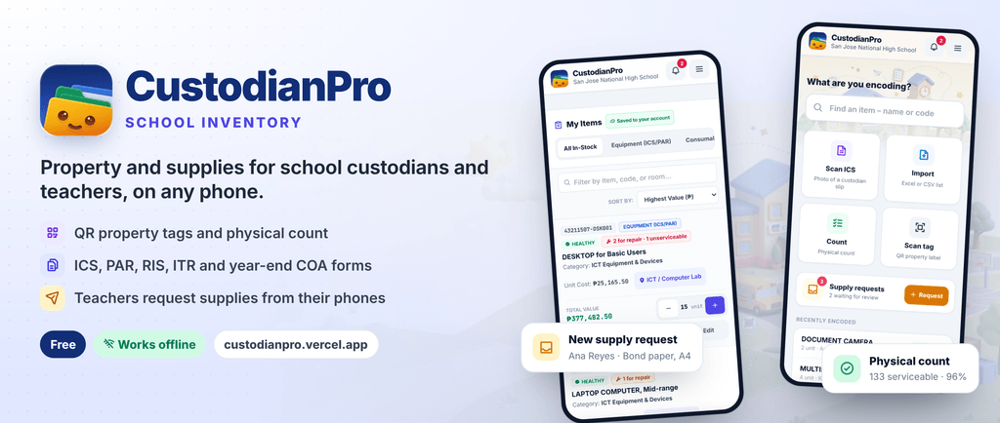

# Portable-School-Inventory



**CustodianPro** – a school general inventory & APP-CSE 2027 counter for property custodians,
optimised for iPad/tablet use. It is a single static page (`index.html`) served by GitHub Pages:

https://jorzyrockz-crypto.github.io/Portable-School-Inventory/

## Signing in

Every phone signs in before using the app. The sign-in screen shows the school art (a tall
picture on phones held upright, a wide one on tablets turned sideways and computers) and asks
who is using the phone:

- **Property custodian**: Google, or email and password. The first sign-in creates the school
  (*School* field). This is the same account that receives teachers' requests and keeps
  the **Inventory** saved online.
- **Teacher**: paste the invite link or type the school code from the custodian. Opening the
  invite link on the phone skips this step and goes straight to *Join*.

After that the app opens straight to Home, also without signal: the phone remembers who signed
in, and Firebase keeps the session. **More → Account → Sign out** (custodian) or **Leave**
(teacher) brings the sign-in screen back. When a custodian's session ends (password changed,
signed out on Firebase), the screen asks them to sign in again, or to start over.

Inventory that was already on a phone before sign-in was required is never lost. The welcome
card says how many items the phone has. On the custodian's first sign-in they become the school
inventory, or are merged with it (the merge question explains the choice).

**Explore without an account.** The button under the welcome card opens the property custodian's
screens filled with the sample data (items, teachers, To review), with no account and no cloud, so
nothing can reach a school. It is handy for a quick look, or for previews on sites where Google
sign-in is not allowed. An amber *Exploring* bar under the header (and More → Account) has **Sign in**.
Everything on the phone is set aside when exploring starts and put back when they leave, so nothing
done while exploring stays behind or is uploaded later. Only the theme and background-picture choices
are kept. Supply requests shows a short note instead of the sign-in form, and opening an invite link
leaves explore mode first.

Without a Firebase project (`firebase-config.js` set to `null`) there is nobody to sign in with,
so the app stays the local-only inventory with no sign-in screen.

## Welcome tour

After a property custodian's first sign-in (a new school), a three-step welcome replaces the bare invite sheet:

1. **Your school:** school name, the custodian's name and position, and the school head. These go on every printed form.
2. **Add your items:** import Excel/CSV, scan a printed ICS, pick from the catalog, or look around with sample data. The choice opens when the tour ends.
3. **Invite your teachers:** the QR code and school code, **Share link** and **Print poster**: an A4 poster with a big QR code and three steps for the faculty room (also in the invite sheet).

It is shown once per phone. **More → Welcome tour** opens it again.

## Questions and messages

Every question and message (*Sign out of CustodianPro?*, *Take back …?*, *Reason for declining*, *Restart now to update?* …) opens in the app's own dialog instead of the browser's “custodianpro.vercel.app says” box. Each one has a clear title and named buttons (**Sign out** / **Cancel**, **Restart** / **Later**), follows light/dark, and works with the keyboard (Enter, Escape, Tab). Tapping outside doesn't close it, so a stray tap can't lose an answer.

In code, use `appAlert(message, opts)`, `await appConfirm(message, opts)` and `await appPrompt(message, value, opts)` (`opts`: `title`, `ok`, `cancel`, `tone` = `ask`/`warn`/`danger`/`good`/`info`, `icon`, `label`, `placeholder`, `multiline`, `required`). Never use `alert` / `confirm` / `prompt`: the end-to-end tests report a native box as an error.

## Light and dark

The app follows the phone's light or dark setting. **More → Appearance** (teachers: at the
bottom of their screen) switches between **System**, **Light** and **Dark**. The choice is
applied before the first paint, so there is no white flash when opening the app at night.
Printed forms always use the light look. In dark mode the sign-in screen and the strip behind Home use a night version of the school picture, and the selected option of every switch (System/Light/Dark, My Items/Requests, transfer type…) is a lighter raised pill.

### Background picture

The faded school picture behind the top of the page shows on **Home** by default. Under
**More → Appearance → Background picture on**, each tab has a tick box: **Home**, **Inventory**,
**Catalog** and **Reports**. Teachers get one *Background picture* switch for their screen.

- The choice is saved on the device, like light / dark (`custodian_page_art_v1` in local storage, a list of tabs; missing means the default). It is kept after a restart and follows other open tabs.
- The header turns to frosted glass wherever the picture is on.
- On phones, Inventory and Catalog normally run edge to edge under the top bar. With the picture on, their card floats with a 16 px gap and rounded corners, as on wider screens, so the picture shows around it.
- `tests/e2e/login-theme.mjs` (section 5b) checks:
  - the default;
  - ticking and unticking;
  - the floating card on a phone;
  - that the choice is kept after a restart;
  - the teacher's switch.

Dark colours are generated, not hand-written: `scripts/dark-theme.mjs` reads the Tailwind
colour classes in `index.html` (`bg-white`, `text-slate-900`, `bg-amber-50`,
`hover:bg-slate-50` …) and writes an `html.dark` counterpart for each one into
`assets/app.css`. New classes are picked up on the next `npm run build`.

## On a phone

CustodianPro is laid out for a 360–430 px phone first and widens on tablets and computers:

- Pop-ups become **bottom sheets** below 640 px (the `.sheet-sm` class on the overlay): full width, rounded top, buttons above the home indicator.
- Lists stack on a phone: **Inventory** rows are one tidy line per item (see below); **Catalog** rows are one line per item with a small − qty + on the right.
- Every tap target is at least 32 px (most 40 px); headers wrap their buttons onto a second row instead of squeezing the title.
- Toasts sit above the bottom tabs, move to the top while a sheet is open (also when the sheet opens after the toast), and go to the bottom on the sign-in screen so the logo stays visible.
- `tests/e2e/phone-layout.mjs` checks this at 390 × 844: no sideways scrolling, no small buttons, sheets anchored to the bottom, full peso amounts on Reports.
- **Touch tablets** (700 px and wider, `pointer: coarse`) scale the whole UI with the screen width: the root font size becomes `100vw / 42`, between 16 and 20 px, and every size is in rem. The phone-first column then fills the screen (686 of 800 px in portrait) instead of sitting small in the middle. The fixed-px caption classes (`text-[10px]`, `text-[11px]`…) are switched to rem inside that rule. Computers (mouse) and phones keep 16 px. A browser tab zoomed by Chrome reports a narrower width, so it is not enlarged twice. `tests/e2e/tablet-layout.mjs` checks this.
- On touch tablets (640 × 600 px and up), chips, tabs and small links are at least 2.5rem (about 40 px) tall.
- **Computers** (mouse, 1024 px and wider) get a **left sidebar** instead of the bottom tabs: Home, Inventory, Catalog and Reports, then Supply requests (with the number waiting), Teachers and Forms. The top bar spans the window. Inventory and Catalog widen into tables with column headings: category, tagged units (and how many are with teachers) and unit cost in Inventory; category, APP part and value in Catalog. **Forms** opens the government forms as a page beside the sidebar: the groups of forms side by side (three columns on wide screens), so the list fits without scrolling. A long form scrolls the page with Back / Print at the bottom.
- **Tablets held sideways** (touch, 1000 px and wider, 600 px and taller), such as a tablet used as a laptop with a keyboard, get the same sidebar, a little narrower (13rem) with finger-sized rows. Forms is a page there too. The extra Inventory / Catalog columns only show on big tablets (1300 px and up, e.g. a 12.9" iPad Pro), because the tablet's larger text leaves too little room on smaller ones. Turned upright, the tablet goes back to the bottom tabs. Phones keep the bottom tabs, even sideways.

## Inventory (was *My Items*)

The custodian's list of everything the school has (quantity above 0). It was called *My Items*; the teacher's own *My Items* (what was released to them) keeps its name.

- **Top:** *Inventory*, the saved-online chip, `N items · ₱ total`, **Stock in** (a delivery with its actual cost, see [Deliveries](#deliveries-and-actual-costs)) and **Add items** (opens the Catalog). Then a search box (name, code, room, property or serial number, teacher) and a sort menu: highest value, name, room, most / least quantity.
- **Filter chips** wrap onto a second line instead of scrolling sideways, each with its count: *All · Equipment · Consumables · Low stock · Needs repair · With teachers*, plus *Not counted* during a physical count. Chips with nothing in them are hidden.
- **One row per item:** type icon, name (2 lines at most), *room · code*, at most two status labels (repair / unserviceable, low stock, with a teacher, tagged; more show as *+N*), and on the right the quantity and total value. There are no +/− buttons on the rows, so a count can't change by accident while scrolling.
- **Tap a row** for the **item sheet** (a bottom sheet on phones): on hand, unit cost and total value; a low-stock note; the quantity stepper; room, category, condition, property numbers and who has the units (each name opens that teacher's page); a **Prices** row (average cost and last paid) and a **Catalog** row (rename, hide or delete); and **Release · Edit details · History** at the bottom.
- **During a physical count** each row has a check button on the left (tap to mark counted without opening the item), and the sheet has **Mark as counted**, which returns to the list.
- `tests/e2e/phone-layout.mjs` checks the rows, chips, sheet and count mode at 390 px; `release.mjs` and `teachers-overview.mjs` use the sheet for Release and the teacher links.

## Catalog

The full APP-CSE catalog (361 items plus custom ones), where quantities are entered quickly. It uses the same card, colours and white rows as Inventory, and sits below the top bar, not inside it:

- **Card header:**
  - *Catalog*, with *N items · N in stock* (or *Showing X of N* while filtering) and a chip showing the chosen category (tap ✕ to clear it);
  - **Custom item** on the right, where Inventory has *Add items*;
  - a search box (name, code, room) and a **Category** drop-down with how many items each category has. That one control replaced a strip of 30 category pills that ran off the screen.
- **Chips** below, which wrap like Inventory's: *All (count) · Part I (PS-DBM) · Part II (Other) · In stock (count)*, plus *Show hidden (count)* once anything is hidden.
- **Reset all quantities** is at the end of the list. It is rarely needed and asks for confirmation first.
- **One row per item:**
  - the name (2 lines at most);
  - *price / unit · code* (a missing price shows *Set price*), plus the category on wider screens;
  - up to three small labels: the total value and the room when it is in stock, and low stock or repair when needed;
  - on the right, a compact **− qty +** (40 px buttons named *One less* / *One more*; + is light indigo like *Add items*). The quantity can also be typed and is greyed out at 0.
- **Tap the name** to open the item details: room, unit price, minimum stock.
- **−** and **+** update the row in place, so the list doesn't jump and the button you tapped keeps focus.
- `tests/e2e/phone-layout.mjs` checks at 390 px that:
  - the rows are compact;
  - every row has the − / + buttons;
  - the categories are in the drop-down;
  - + and − update the row;
  - tapping a name opens the details.

### Editing, hiding and deleting catalog items

Open an item (item sheet → *Catalog*, or *Edit details* → *Catalog*):

- **Your own (custom) items:** change the name, unit, category and classification. **Delete** is offered only when the item has quantity 0, no property numbers and isn't on any slip, PR or delivery; otherwise it is **archived** (hidden, but kept for past slips and reports). Deleted numbers are not reused.
- **APP-CSE items:** name, unit and stock no. are locked (they come from the DBM list); you can set your own unit cost. They can't be deleted but can be **hidden**.
- Items you still have (quantity above 0) can't be hidden or deleted.
- Hidden items leave the Catalog, Home search and scan suggestions; **Show hidden** lists them with *Show again*.
- Old slips keep the name and cost they were printed with. Every change is in Change history and syncs to the school account.

## Sharing and link previews

Links to CustodianPro (and teacher invite links) show a large preview in Messenger, Facebook, Viber, WhatsApp, Telegram, LinkedIn and X:

- `index.html` `<head>`: description, Open Graph and X (`twitter:`) tags, canonical address and WebApplication structured data (features, screenshots, free).
- `assets/brand/og-image.png` (1200×630): the banner, **drawn from the real app**. It shows the current Home and Inventory screens, so it never shows features the app doesn't have. The image URL carries `?v=<date>`; change it when the picture changes so Facebook and Messenger fetch it again.
- `assets/brand/social-preview.png` (1280×640): the same banner for GitHub (**Settings → General → Social preview**; uploaded by hand).
- `assets/brand/banner.png` / `.webp` (1024×434): the README header and **More → About**.

To redraw after a UI change (with the site served on `BASE_URL`):

```bash
cd tests/e2e
node make-screenshots.mjs   # assets/screenshots/ (install sheet), used by the banner
node make-banner.mjs        # assets/brand/og-image.png, social-preview.png, banner.png/.webp
```

## Planning notes

- [`docs/NOTIFICATIONS_PLAN.md`](docs/NOTIFICATIONS_PLAN.md): which channel is for what (title bar = app updates only), today's notifications, and where new ones would help (low stock, teacher joined, confirm-receipt reminders, year-end count, sync problems, push via FCM).
- [`docs/UI_REVIEW.md`](docs/UI_REVIEW.md): UI inspection findings across phone, tablet and computer, light and dark, with suggested fixes.

## Home screen: encode without distractions

The app opens on **Home**, which only asks one thing: *What are you encoding?*

1. **Type a few letters** of the item name or its stock code. The catalog and your custom items are searched together.
2. **Tap a result**, or press Enter for the top one. A sheet slides up with a big quantity stepper, the unit and one-tap room chips. The chips are rooms you already use plus common school rooms.
3. **Save & next** saves the item, shows an **Undo** toast and clears the search, ready for the next item. Pressing Enter in the quantity field also saves. **More details** opens the full item editor for price, condition, units and so on.

If nothing matches, the last row offers to add what you typed as a new custom item.

When the search box is empty, Home shows:
- three big tiles: **Scan ICS**, **Import** and **Count**. While a count is running, the Count tile shows a progress bar. A **Scan tag** tile appears once you have tagged units.
- your last 5 **recently encoded** items, which you can tap to edit.
- one status line with the number of items, total value and last backup. It links to Reports. The backup reminder appears here only when a backup is overdue.

Everything else moved out of the way:

| Where | What |
| --- | --- |
| **Inventory** tab | everything the school has (quantity above 0): search, filter chips, tap an item for its sheet; the physical count checklist while counting |
| **Catalog** tab | the full APP-CSE catalog: search, category drop-down, part / in-stock chips, one row per item with − qty + |
| **Reports** tab | valuation, condition, property tags, categories, rooms, print and APP-CSE summary |
| **☰ More** menu | add custom item, import, scan ICS / QR, print, CSV exports, school info, backup, restore, change history, sample data (load / clear) |

## Supply requests & Purchase Requests

Teachers request supplies from their own phones; the custodian reviews each request, checks it against stock, approves it, and turns approved requests into a **Purchase Request (Appendix 60)**.

**Teacher**
1. Open the invite link (or scan the QR code) the custodian shared, or choose **Teacher** on the sign-in screen and paste the link or type the school code. The school's 6-digit DepEd **School ID** (e.g. `114656`) works too. Then type your name, position and grade/section once.

   **School ID.** The ID comes from the school name in School info (`114656 - San Jose NHS`). When the custodian signs in or opens Invite, the app lists it under `schoolIds/114656`. Only an exact ID can be looked up, and each ID belongs to one school: the first to list it keeps it, and the Invite screen tells a second school that it's taken. School IDs are public, so anyone could find the school, but new teachers still wait for the custodian's **Approve**. After **New invite link**, the School ID alone no longer works and teachers need the new link or code.
2. Tap **New supply request**, search for items (e.g. “bond paper”, “ballpen”) or type anything not in the catalog, set quantities, add a purpose and a needed-by date, and send.
3. Follow the status on the same screen: *To review → Approved → Being purchased (PR No.) → Supplied*, or *Declined* with the custodian’s reason. A pending request can still be cancelled.

A teacher’s phone only shows that teacher’s own requests, slips and items. It never shows the school inventory, prices, equipment or who holds what. The one exception is **School stock**, a list of how much of each supply is left (see below).

### Joining: approval, removing and new invite links

- **Waiting for approval.** A teacher who opens the invite link joins as *pending*. They see *Waiting for approval* and can't send requests or see the stock yet. The custodian gets a notification (*Ana Reyes wants to join your school*), and the Teachers page shows them under **To review**. **Approve** lets them in, and the teacher is told *You’re in!*. **Not from our school** refuses them.
- **Edit details.** On a teacher's page, **Edit details** corrects the name, position and office. Their phone takes the corrected details.
- **Remove from school.** The teacher can no longer send requests, see the stock or send reports (the rules refuse it). Their slips, items and history stay. Removed people are listed at the bottom of the Teachers list, where **Add back** brings them back.
- **New invite link** (in the Invite sheet) replaces the link. Anyone opening an old link is told it was replaced by a newer one. Teachers who already joined are not affected.
- **DepEd School ID.** If the school name starts with the 6-digit School ID (*114656 - San Jose NHS*), the join sheet and the poster show *School ID 114656*. It is a label so teachers can tell they picked the right school. It is not a password, since School IDs are public.

Teachers who joined before approvals existed stay active; only new joins need **Approve**.

### School stock and “I took this” (teachers)

Teachers kept asking *“Sir, meron pa ba nito?”*. The teacher's phone now has a third tab, **Stock**:

- Every **supply** with the exact number left (*85 ream left*), searchable, with **Low** and **Out** filters. Equipment, prices and holders are never shown. The custodian's devices publish only the code, name, category, unit and quantity (`schools/{id}/stock/{code}`).
- **Request** on a line opens a new supply request with that item.
- **I took this** (*“Mam, kumuha ako ng ganito sa office”*): pick the quantity and add a note. The number left drops right away on every teacher's phone, marked *2 taken · waiting for the custodian to confirm*. The custodian sees *Took it* on Supply requests and gets a notification. **Confirm · RIS** opens the release with the lines filled in, and saving the RIS settles the stock. **Decline** puts the quantity back, and so does the teacher cancelling (*I didn’t take it after all*).
- Supplies only. Equipment still needs an ICS / PAR from the custodian. Under COA rules the custodian issues the RIS, which is why “I took this” waits for the custodian's Confirm.

**Custodian**
1. On the sign-in screen choose **Property custodian** and tap **Continue with Google** (or use email and password). The first sign-in creates your school. Requests are under **Supply requests** on Home (also in ☰ More).
2. Tap **Invite** and send the link or QR code to your faculty group chat.
3. **To review**: open a request to see *asked / on hand / to buy* for every line. Edit names, quantities, units and unit costs, link a line to an inventory item, add a note, then **Approve** or **Decline** (with a reason). You can also enter walk-in requests with **New**.
4. **To purchase**: tick approved requests and tap **Prepare Purchase Request**. Only the quantity not in stock goes on the PR (asked minus on hand, editable). Identical items from several teachers are added together, and their names go in the Purpose.
5. Check the PR header (entity, fund cluster, office, PR No., responsibility center code, date), the lines and the signatories, then **Save & print**. Saved PRs are listed under **Purchase requests**, where you can reprint them or save them as **Excel** (.xlsx) or CSV. The Excel file is laid out like the printed Appendix 60 (A4 portrait), and Total Cost and the grand total are formulas, so it can still be edited. A line with no stock no. shows its line number (1, 2, 3…), as many schools write it. Mark a request **Supplied** once the items are handed over.

### Supply requests: Firebase setup

The app is connected to the Firebase project **russapps-custodianpro** (settings in [`firebase-config.js`](firebase-config.js)). In the [Firebase console](https://console.firebase.google.com/project/russapps-custodianpro), do these once:

1. **Build → Authentication → Get started → Sign-in method**: turn on
   - **Google** (custodian, and teachers who want their requests on every phone). Pick a support email and save.
   - **Anonymous** (teachers who just type their name). If it's off, the join sheet can't load the school with just a name. It says so (no red error) and lets the teacher join with **Continue with Google** instead, then shows the school name and ID.
   - **Email/Password** (optional: custodians without a Google account).
2. **Authentication → Settings → Authorized domains**: add `jorzyrockz-crypto.github.io`. Without it, Google sign-in shows “This website is not on the Firebase authorized domains list”.
3. **Build → Firestore Database → Create database**: pick a location near you (e.g. `asia-southeast1`, Singapore) and start in **production mode**.
4. **Firestore → Rules**: replace the contents with [`firestore.rules`](firestore.rules) from this repository and click **Publish**. These rules let teachers create and read only their own requests. Only the school’s custodian can list requests and create Purchase Requests. Only Google or email accounts can set up a school. Nothing can be deleted, except by the school's custodian through **Reset app** (below). **Publish again after updating the app** when `firestore.rules` changed (latest: custodian-only delete for Reset app, and the `schoolIds` lookup for joining by School ID).

The config values are not secret; access is controlled by the published rules. To use a different project, replace the object in `firebase-config.js` (or set it to `null` to hide Supply requests).

**Switching to another project.** Data stays in the old project, so nothing moves over by itself. Each phone remembers which project it last used. On the first open after the switch, the app keeps the phone's inventory, history and settings, clears its link to the old school, and asks the custodian to sign in again.
- **Custodian:** signing in creates the school in the new project, and the Inventory uploads everything.
- **Teachers:** need a new invite link.

**Sign-in**
- **Custodian:** *Continue with Google* (or email + password). The first sign-in creates the school; signing in on another phone or tablet finds it again.
- **Teacher:** open the invite link, type your name, and tap *Continue* (no account needed), or *Continue with Google* to keep your requests when you change phones. You can also link Google later from the teacher screen.

**Offline**
- After the first online visit, the app and the sign-in stay on the phone.
- Firestore keeps a copy of the requests and Purchase Requests on the device, so the lists open without signal.
- New requests, approvals and PRs made offline are queued, marked *Sending…*, and sent automatically when the phone reconnects (also after the app is closed and reopened).
- Signing in for the first time needs internet.

## Equipment condition tracking

For equipment (ICS/PAR) items, the item editor records how many on-hand units are
**Serviceable**, **Needs Repair** or **Unserviceable** (serviceable is computed so the three
always add up to the quantity). The split appears on the dashboard ("Equipment Condition"),
in the ledger's *Repair / Unserviceable* tab, in the printed report's *Condition* column, and as
three extra columns in the CSV export — handy for the RPCPPE physical count and IIRUP disposal.

## Property numbers, QR labels & scanning

Equipment can be tracked **per unit** instead of only as a count:

1. In the dashboard ledger, tap the purple **QR** button on an equipment item (or *Tag units* in
   the item editor), then **Tag N units**. Each unit gets a property number such as
   `SJNHS-2026-0001` (prefix = school initials, or set your own under *School Info*). Any number
   can be edited to match a sticker that is already on the item. The condition counts already
   recorded for the item carry over to the new units.

   **One number per ICS line.** Many schools give one inventory item no. to a whole ICS line
   (9 file boxes → one number). Under *School Info → Property numbers* choose *One number per ICS
   line*: new numbers then look like `OES-4THQ-2026-11-31` (School · Quarter · Year · Month ·
   Series), the series continuing through the year, and every unit of the line (or of one
   delivery line, or of one *Tag N units*) shares it. A scanned ICS whose line has one number for
   several units always shares it, whatever the setting. Slips, forms and the CSV list a shared
   number once; renaming may give a unit the number of another unit of the same item (not of a
   different item); and during a physical count each scan of the shared sticker counts the next
   unit of the batch.

   **COA standard (automatic).** The third choice decides by the cost of each unit, following
   [COA Circular 2022-004](https://www.coa.gov.ph/) (semi-expendable property): low-valued items
   (₱5,000 and below a unit, §4.8) share one number per line, while high-valued items (above
   ₱5,000), PPE (₱50,000 and up) and units with no cost yet get one number each, in the same
   School · Quarter · Year · Month · Series form. Releases put low- and high-valued items on
   separate ICS slips (§4.14), numbered `SPLV-YYYY-MM-NNNN` and `SPHV-YYYY-MM-NNNN`, each with one
   serial series per year.

   New schools start with *COA standard (automatic)*. Schools set up before it came keep their
   setting (a saved school info without a numbering choice means *One per unit*).
2. Per unit you can record the serial number, location, who it is assigned to, and its condition.
   Once an item has units, its Serviceable / Repair / Unserviceable counts come from the units.
   **Remove unit** (trash button) asks for the reason (disposed, transferred to another school,
   lost, stolen, destroyed… or your own text) and keeps the unit under *Written off*, like a relieved
   unit: not counted, its number never reused, kept for audit. Untick *Keep it under Written off*
   only for a unit added by mistake. Undo puts it back.
3. **Print QR labels** – 3 across on A4/Letter; cut them out, or print on sticker paper.
4. **Scan** (bottom bar, or *Scan Tags* on the dashboard) opens the camera. Each label scanned
   is marked *verified today*, and the dashboard shows how many units were verified this year,
   which helps with the annual physical count. Numbers can also be typed in by hand.
5. **Property register (CSV)** exports one row per unit. The printed report and the inventory
   CSV list each item's property numbers.

On-hand quantity can't go below the number of tagged units; remove a unit (disposed of,
transferred or lost) from its list first. The QR generator and reader are bundled in
`assets/vendor/`, so tagging and scanning work offline too. The camera needs HTTPS (GitHub Pages
is fine) and permission to use the camera.

## Change history

Every change is recorded automatically with the date, time and custodian name:
- counts (taps on the same item within 3 minutes are merged, e.g. *Quantity 12 → 15*)
- prices, minimum alert levels, locations and classification
- condition
- property numbers: tagged, renamed or removed (with the reason you enter), plus scans and
  label printing
- school info, sample data, reset, backups and restores

Open it from **Change History** in *Quick Custodian Tools*, or from the clock button in the item
editor / *History* in the property-number list to see one item. You can filter by type, search,
and **Export CSV**. The latest 3,000 changes are kept on the device and included in backups.

Bulk saves (releases, returns, take-backs, transfers, ICS scans, deliveries, Purchase Orders)
are one entry that lists every item it touched, so they also show in each item's history.
Releases, returns, transfers and deliveries are also read from the slips and delivery records in
the school account, so those made on another device (or before this device's log began) appear
too, marked *School account*. One made on this device is not listed twice. Counts, prices and
other edits stay in the log of the device where they were made.

## Importing from Excel or CSV

Already keep your inventory in a spreadsheet? Tap **Import** (in *Quick tools*, or
**Import Excel / CSV** on an empty dashboard) and choose an `.xlsx` or `.csv` file.

- The first sheet is read. Title rows above the column headings are fine — the app
  finds the header row and guesses which column is the description, quantity, item code,
  unit, unit cost, room/location and repair/unserviceable counts. Change any of them
  before importing. The DepEd RPCI layout works as-is (it uses *On Hand Per Count*,
  not *Balance Per Card*).
- Rows are matched to the APP-CSE catalog by item code, then by description (case and
  spacing don't matter). Several rows for the same item, such as one row per room, are
  added together. Rows that don't match can be added as custom items.
- **Replace** sets each quantity to the number in the file; **Add to current** adds it
  to what you already have. Quantities never go below the number of tagged property
  units.
- Every import makes one Change History entry, and you can **Undo** it right away.
- The file is read on the iPad itself and is never uploaded. Old `.xls` (Excel 97-2003)
  files aren't supported — in Excel use *Save As › Excel Workbook (.xlsx)* or *CSV*.
- A CSV made with **Export CSV** imports straight back, so it doubles as a simple
  spreadsheet round trip.

## Physical count progress

Tap **Start count** on the dashboard, give the count a name (e.g. "Year-end count
2026"), then go around the school checking items off:

- Each ledger row gets a check button. Changing an item's quantity or saving it also
  marks it as counted.
- The progress bar shows how many items are counted out of all items you have in
  stock. **Not counted** filters the ledger to what's left.
- **Finish** shows which items were missed and writes a summary into Change History.
- The count survives closing the app and is included in JSON backups.

## Deliveries and actual costs

**Home → Deliveries** (also *More → Deliveries* and Inventory's **Stock in**) records what you actually paid.

- **Stock in:** supplier, date received, IAR no., DR / invoice no., PO no., and per line the item, quantity, unit and unit cost. Stock goes up when you save, with **Undo** right after.
- **Scan PO:** a photo (or pasted text) of a **Purchase Order** is read like the ICS scanner (PO no., date, supplier, PR no., stock no., unit, description, quantity, unit cost, amount; quantities cross-checked against the amounts). Saving makes an **expected delivery** and does **not** change stock.
- **Received:** open the PO and tap *Received*. Enter what came, all of it or only part, with the IAR or DR no.; only then does stock go up. A partly received PO stays open for the rest. **Scan IAR / DR** reads an Inspection and Acceptance Report or delivery receipt; when it names a waiting PO it is linked to it.
- **Costs:** supplies keep an **average cost** across deliveries. Each equipment unit gets its own property number and its **own cost**, and that unit cost decides PAR (₱50,000 and up) or ICS when it is released, transferred or reported lost. A PR marked delivered uses the PR unit cost.
- **Price history:** every item has a *Prices* window: unit cost now, last paid, each delivery (cost, quantity, supplier, document) and corrections with a reason. The PS-DBM price shows as *PS-DBM price (APP-CSE 2027)*, for reference only. New PR lines show what you last paid. Items you already had keep their current price as the starting cost.
- **Reading real forms:** tuned on DepEd PO (Appendix 61), IAR (Appendix 62) and ICS screenshots. Amounts that lost a decimal point or a digit (`21500`, `10.280.90`, `6.400.020`) are repaired from *quantity × unit cost = amount*, and a line where two repairs are possible is settled by the total printed under the table; the review says *Lines add up to the total on the paper* or shows the difference. An IAR names its PO (*PO No./Date*), and its rows are matched to the PO lines by stock no.; a quantity that can't be read shows what is still to come, with a note. Small screenshots (under 1000 px wide) are enlarged more before reading.
- **Matching:** the scanner suggests catalog items, tolerates reading slips (*BOND PAPFR*), and **remembers** your pick for a supplier's wording, so the same wording is matched by itself next time. A warning shows when the paper's unit (box) differs from the item's (piece).
- Deliveries are saved in Change history, in backups, and in the school account (`settings/dlv-…` and `settings/matches`), so every custodian device sees them.
- `tests/e2e/deliveries.mjs` covers PO reading, the expected → partly received → received flow, average cost, price history, per-unit PPE, remembered matches, Undo, Catalog editing and the sync to a second device.

## Scanning a printed ICS

Encode an approved **Inventory Custodian Slip** (COA Appendix 59) from a photo instead of
typing it. Tap **Scan ICS (Inventory Custodian Slip)** in *Quick tools* or in the
*Property Tags* panel, then **Take photo of ICS**.

- The photo is cleaned up on the phone or tablet (straightened, adaptive black and
  white, table lines removed) and read with [Tesseract.js](https://github.com/naptha/tesseract.js).
  Nothing is uploaded. The first scan downloads the text reader (about 7 MB); after
  that, scanning works offline.
- You get an editable review before anything is saved:
  - **Header:** ICS No., date received, received by (accountable person) and position.
  - **Each line:** quantity, unit, unit cost, description, inventory item no. and
    estimated useful life.
  - **Save to:** the suggested catalog item, or a new custom item.
- Quantities are cross-checked with the money columns (total cost ÷ unit cost).
  Look-alike letters in item-number prefixes (SJNHS / SINHS) are corrected against your
  property-number prefix. Each line notes anything that was guessed or corrected.
- **Save** adds the quantities to stock (untick for items already counted that the ICS
  only assigns). It also creates one property record per unit with the inventory item
  no. (ranges like `SJNHS-2026-0101 to 0105` are expanded), the ICS No. and date, the
  useful life, and the person who received it. Units without an item no. get the next
  numbers in your series. Items on an ICS are marked ICS/PAR (equipment).
- Amounts with a lost decimal point or a misread digit are repaired from quantity × unit cost = total cost (each repair is noted on the line). *Received by* is found whether it is the left or the right signature column. An inventory item no. that wrapped onto two lines in the cell and was only half read (`OES-4THQ-2026-`) is flagged and blocks saving until it is typed in full or cleared (cleared lines get the next numbers in your series).
- Re-scanning an ICS No. that was already encoded shows a warning, and inventory item
  numbers that already exist block saving. One Change History entry is written, with
  **Undo** right after saving.
- No camera reading? Under **Paste text instead**, paste text copied with Google Lens
  (*Select text › Copy*), Samsung *Extract text*, or the cells of the ICS Excel file.
- Typed or printed ICS work well. Handwriting is not read reliably. Lay the page flat
  in good light and fill the screen with it.

The property register CSV now also lists ICS No., ICS date and estimated useful life.

## Equipment vs. consumable classification

Each item is automatically classified as **Equipment (ICS/PAR)** or **Consumable (RIS)** by
category, by name (e.g. CHAIR, CABINET, WHITEBOARD, ROUTER, UPS – regardless of unit) and by
price (anything counted per "unit" costing ₱500 or more). If an item is classified wrongly,
open it and pick **Equipment** or **Consumable** under *Classification*; choose **Auto** to go
back to the automatic rule. Custom items can be classified when they are added.

## Releasing items to teachers

Teachers who join with the invite link are listed automatically (their phone sends their name, position and office). The custodian releases items from stock:

- **From a request:** an approved request with everything in stock, or a delivered one, has a **Release** button. The teacher and the approved items are filled in.
- **From Inventory:** tap the item, then **Release** in its sheet. Or tap **Release** at the top of Supply requests.
- **Supplies** go on a **RIS** (Requisition and Issue Slip, Appendix 63) and leave the stock count.
- **Equipment** goes on an **ICS** (Inventory Custodian Slip, Appendix 59). It stays in Inventory, and each unit shows *With Ana Reyes · ICS 2026-11-001*. Pick which property numbers to hand over. Units without one get the next number automatically.
- **Equipment worth ₱50,000 or more** (PPE under COA Circular 2022-004) goes on a **PAR** (Property Acknowledgment Receipt, Appendix 71) instead. One release can create an ICS and a PAR; each line says which slip it goes on, and the unit shows *With Ana Reyes · PAR 2026-11-001*.
- Numbers run per month (`2026-11-001`, …), separately for RIS, ICS, PAR, ITR, PTR and RRSP. The slips print from the done screen.
- Someone without an account (e.g. utility staff) can be typed in. The slip still prints.

**Items delivered** on a Purchase Request now adds the items to the stock in Inventory. Items that weren't in Inventory yet are added as new items. The requests then show *Ready* to the teacher until you release them.

**Assigned to** (Property Numbers) suggests the teachers. Picking one links the unit to that teacher's account. Names typed earlier or read from a scanned ICS (e.g. *MR. JUAN D. DELA CRUZ*) are linked automatically when *Juan Dela Cruz* joins. Titles, middle initials and *Last, First* order are ignored. Two teachers with the same name are left for you to pick.

Every release, assignment and return is kept as a record under the school (`releases`), and nothing is ever deleted. A teacher can read only the records made out to their own account. Teachers can't see the school inventory or the list of other teachers.

> Publish the updated [`firestore.rules`](firestore.rules) again after updating. The new parts are `members` and `releases`.

## Transfers between teachers and rooms

**Transfer** on a person's page (or on a unit in Property Numbers) moves equipment to another teacher, or to a new room with the same teacher:

- Tick the units, pick the new accountable person (or *Same person, new room*), the new room, the transfer type (**Donation**, **Reassignment**, **Relocate**, **Others**) and the reason.
- Items below ₱50,000 go on an **ITR** (Inventory Transfer Report, Annex A.5), items of ₱50,000 and up on a **PTR** (Property Transfer Report, Appendix 76). Each line keeps the unit's earlier ICS/PAR no.; the school head signs as *Approved by*.
- The new holder gets a notification and confirms the slip under **New from the property custodian**. The old holder's list drops the units and their history shows *Transferred out*. A room change alone isn't a new item to confirm.
- Every unit in Property Numbers has an **Accountability history**: issued, transferred, moved and returned, with the slip numbers.
- **Take back** and accepted returns print an **RRSP** (Receipt of Returned Semi-Expendable Property, Annex A.6) with its own number.

## Government forms

**Reports → Government forms** (also in **More**) fills the year-end COA/DepEd forms from what the app already knows, printed on A4 (the wide ones in landscape):

| Form | What it uses |
| --- | --- |
| **RPCPPE** (Appendix 73) / **RPCSP** (Annex A.8) – physical count | Each tagged unit counts as found when its QR was scanned or it was checked in the physical count since the chosen date. Shortage quantity and value, holder and room in Remarks. |
| **IIRUP** (Appendix 74) / **IIRUSP** (Annex A.10) – unserviceable property | Units marked *Unserviceable* in Property Numbers, with blank inspection, disposal and sales columns to fill in by hand. |
| **RLSDDP** (Appendix 75) / **RLSDDSP** (Annex A.9) – lost, stolen, damaged or destroyed | Tick the units (those a teacher reported *Lost or missing* start ticked), the nature, police report and circumstances. The accountable officer, designation, office and PAR/ICS no. come from the unit's holder. |
| **Property Card** (Appendix 69) / **SPC** (Annex A.1) | One card per equipment item. Quantities added or dropped (from the change history) change the balance; every PAR / ICS / PTR / ITR shows who received the units, and RRSPs show returns. Issued units stay on the balance, since they are still the school's property. *Print all* puts one card per page. |
| **RegSPI** (Annex A.4) – registry of semi-expendable property issued | ICS (issued), ITR (re-issued) and RRSP (returned) in the period, with the quantity still with end users and its amount. |
| **RSPI** (Annex A.7) / **RSMI** (Appendix 64) – issued in a month | Every ICS line (with property numbers) or RIS line (with stock no.) in the period, the total, and for the RSMI the recapitulation by stock number. Serial no., responsibility center code and the accounting staff are typed in. |
| **Stock Card** (Appendix 58) | One card per supply in stock: quantities received (history), every RIS with the office, and the balance after each line. |
| **Supplies to reorder** | Supplies at or below their re-order point (*Min alert qty*), with a suggested order up to twice that level. Print it, download a CSV, or tap **Purchase Request** to start a PR (Appendix 60) with those lines. Out-of-stock items only appear if they were stocked before. |
| **Slips & receipts** | Every RIS, ICS, PAR, ITR, PTR and RRSP made, filtered by form, to print again. |

### Date acquired, useful life and depreciation

Each tagged unit's card (Property Numbers) has **Date acquired** and **Estimated useful life**. Scanning an ICS on receipt fills the date with the slip's date. Later ICS/PAR/PTR dates are issue dates, so they are not used. Filling in one unit offers to copy the value to the item's other units. A blank useful life uses the usual life for the category (10 years for furniture and measuring equipment, 5 years for the rest), marked *est.* Both are columns in the property register CSV.

- They fill the Date Acquired and Estimated Useful Life columns on the Property Card, RegSPI, PAR, ICS/ITR/PTR and IIRUP. A card's first line is the real receipt date instead of *Balance forward* when every unit has one.
- **Depreciation** (PPE only, ₱50,000 and up): straight-line, 5 % residual value, charged monthly from the month after acquisition. The unit card shows the carrying amount, and the IIRUP fills *Accumulated Depreciation* and *Carrying Amount* with a total row. Semi-expendable property is expensed when issued, so it shows none.

The inventory committee, COA representative, fund cluster and similar names are remembered for next year; *As at* is always today unless changed. The cards and the Stock Card start with *Balance forward* on the chosen date and are worked out backwards from today's quantity, so the last line always matches Inventory. Since November 2026 the change history also keeps how much each item changed in bulk saves (deliveries, imports, ICS scans), so those show up as receipts.

## A teacher's My Items

On a teacher's phone the screen has two tabs: **My Items** and **Requests**.

- **New from the property custodian:** each RIS or ICS released to the teacher, with a **Received** button. The custodian's records show who confirmed.
- **Accountable equipment · ICS:** every unit under the teacher's name, with its property number, serial, ICS no. and value. Returns are subtracted. Each unit has two actions:
  - **Report a problem:** needs repair, not working, lost or missing, or something else, plus a note.
  - **Return:** the item stays on the list, marked *Return requested*, until the custodian marks it received back.
  - **Many items:** units of the same item make one row (*Monobloc chair × 20 · 20 units · ₱…*) with a count of any *reported / in repair / lost* units. Tap it to see each property number with its own **Report** and **Return**. With 6 units or fewer the rows start open. From 8 units, a search box finds an item, property number or slip.
- **Supplies received · RIS:** this quarter's slips, newest first. Older slips fold under **Earlier · N slips**, grouped by quarter (*Jul–Sep 2026 · 3 slips*). *Report a problem* covers fewer than released, damaged, or wrong item.
- Reports sent without signal are queued (*Sending…*) and go out when the phone reconnects.

The custodian sees open reports at the top of the **Teachers** page under **To review**, labelled *Equipment report*, *Year-end count* or *Return* (and on that teacher's page). Home shows *Teachers · N to review*, and the Teachers tab, More → Released to teachers and the bell each show a count. **Supply requests** now counts only supply requests:

- **Mark for repair** sets the unit to *For repair*. The teacher sees *In repair*. When it comes back, tap **Repaired · back in use** on the unit (the teacher's page under Teachers). It goes back to serviceable, and the teacher gets a notification.
- **Mark unserviceable** also asks **Take it back now?** If yes, an RRSP is made, the unit leaves the teacher's list, and it waits in stock, still unserviceable, for the IIRUP / IIRUSP and disposal. Otherwise use **Take back** later.
- **Start lost report** (lost or missing) flags the unit *Lost* and opens the RLSDDP / RLSDDSP with it ticked. The unit stays under the teacher's name, their accountability, until you tap **Found** or **Relieve** on it. **Relieve** asks for a reference (e.g. *RLSDDSP No. 2026-001*), takes the unit off the teacher's list and **writes it off**: it is no longer counted (quantity − 1), but the item keeps it under *Written off* (in the units sheet) with its property number, ICS / PAR no., cost, who was relieved, the date and the reference, for the COA auditor. Written-off numbers are never given out again, and scanning a written-off sticker says so instead of *Not found*. The **Lost** filter on the Teachers page lists everyone with lost units, for the year-end count.
- **Received back** clears the assignment. The unit is back in stock, and a return record is kept.
- **Decline** asks for a reason. **Noted** closes a report without changes.
- The teacher sees the answer on the item.

Teachers create only their own reports and read only their own. Only the custodian can resolve them (`teacherReports` in `firestore.rules`).

## Released to teachers (overview)

**More → Released to teachers** (or **Teachers** on Supply requests) lists everyone who holds something:
- teachers who joined;
- anyone items were released to;
- names typed or scanned under *Assigned to*. These show as *No account*, and appear even if you never signed in.

Each person shows their equipment units and value, plus *to confirm* (slips they haven't marked Received) and *open* reports. Search by name, item, property number or serial.

A person's page lists:
- **Accountable equipment:** taken from Inventory. It shows condition, ICS no., and *Confirmed* when the teacher tapped Received. **Take back** returns a unit to stock unassigned and keeps a return record.
- **Supplies received (RIS):** with a reprint button for each slip.
- **History:** releases, assignments, links and returns.

**Print accountability** gives a *Summary of Accountability* for one person. **Print all** gives one page per person. Each summary covers:
- equipment on ICS (ICS no., date, inventory item no., description and serial, condition, unit cost and total);
- supplies on RIS;
- signature lines for *Certified correct* (the teacher) and *Verified by* (the custodian).

In Inventory, an item's sheet lists who has its units (*Ana Reyes · 1 unit · ICS 2026-11-001*); tapping a name opens that person's page.

**Finding people.** Filter chips narrow the list: *Has items*, *To confirm*, *Open reports*, *Not counted yet*, *No account* (typed names) and *Hasn't joined* (holds items but never opened the invite link). **Sort** by name, value, units or the oldest unconfirmed slip. A row shows *1 for repair · 1 unserviceable* when units need attention; tapping it opens the IIRUP.

**Not confirmed yet.** A person's page says *ICS 2026-11-003 not confirmed for 12 days*. **Remind** puts a notification in the teacher's bell (*Reminder from the property custodian*).

**Property clearance** (transfer, retirement, resignation, leave). **Clearance** on a person's page:
- lists what they still hold, with **Transfer all to…** and **Take back all** (one RRSP for everything);
- once nothing is left, prints a **Certificate of No Property Accountability** with what they returned or transferred, signed by the custodian and noted by the school head.

**Same person as…** On a typed name (*A. Reyes*), pick who it really is (*Ana Reyes*, same last name listed first). Units, slips and history move over. With an account, the units also show in the teacher's **My Items** (as a linked ICS when they were never on a slip).

**Remove from the list** (bin icon on the page). This is for a typed name with no account and no units left, such as a test release or a typo. Slips can't be deleted because they are accountability records, so the name's slips are marked **Cancelled**, with who did it and when kept on the server. They are hidden from the list, prints, totals and supply usage, and their numbers are never reused. Supplies on its RIS go back to stock. A name that still holds units needs a transfer or return first. The list says *Typed on a slip* for names that come only from slips.

**Year-end count by teachers.** In December and January, a teacher's **My Items** asks *Are the 3 items on your list with you?* They tap **All present**, or **Missing or broken…** to mark each one (any time of year: **Count my items**). Units they have count as checked for the RPCPPE / RPCSP. The custodian sees *Counted 2026: 8 of 10* per person, and anything missing or broken under **To review** on the Teachers page (*Mark broken for repair*); missing units are suggested on the RLSDDP. Outside the count season the year shown is the calendar year.

**Supply usage** (header button, and on each person's page) totals RIS by item per quarter of the calendar year or per school year (June–May), for planning the APP-CSE. **CSV** exports it per teacher.

**Print my list.** Teachers print their own *Summary of Accountability* from **My Items**.

On a computer or a tablet held sideways, the list stays on the left and the person picked opens on the right, with their equipment as a table. While nobody is picked, the right side shows **To review**: one card per item (*Wants to join*, *Year-end count*, *Equipment report*, *Return*, each with its colour) in a single row that scrolls sideways, with **‹ ›** arrows when they don't all fit. Each card has a category icon (a person for joins, a clipboard for counts, the reason the teacher picked for reports: wrench, x, question mark…). The cards size to the space: as many whole cards as fit plus a peek of the next, or, with fewer items, they share the row; on large monitors (1680 px and up) the page widens. The list's own scrollbar is hidden; a soft fade at its edge shows there is more. On a phone the row swipes, the next card peeks in, and *2 of 3* and dots show where you are; long notes are cut to two lines (tap to read). A person's own page keeps their reports stacked; a *To review* row at the top of the list brings it back, and a person's own open reports show on their page. On a phone, To review sits under the page title.

> Publish the updated [`firestore.rules`](firestore.rules) again: they add member approval (`status` on `members`), invite links that can be replaced (`invites`, `inviteOnly`), **School stock** (`stock`, `stockHolds`) and requests of kind `took`. Until then, approvals, the stock list and “I took this” are refused.

**Reset app.** More → *Reset app…* starts clean, after testing or before the school uses the app for real. Pick one option, optionally tap **Back up**, then type **RESET**:

- **Only this device:** clears everything stored on this phone or computer: inventory, change history, forms, sample data, settings, notifications, sign-in and Firestore's offline copy. The page then reloads like a new install. The school in the cloud is kept, so signing in again brings it back.
- **This device and the school in the cloud** (custodian, online): first marks the school as being erased, so teachers' phones can't add anything. Then it deletes every document of the school (inventory, catalog, settings, teachers, RIS / ICS / PAR and returns, reports, requests, PRs, stock, holds, invite links), its School ID entry and the school itself, and finally clears this device. Teachers' phones show *San Jose NHS was reset* with **Leave**, and they join again with the new link or School ID. The custodian's sign-in account stays: signing in again asks for the school name and makes a new, empty school. This needs the current `firestore.rules` published. With older rules Firebase refuses, and nothing is reset.
- On a teacher's phone, **Reset** (next to Leave) clears only that phone. Their requests and reports stay with the custodian.

**Sample data.** More → *Load sample data* adds sample counts plus six sample people (Ana Reyes, Ben Cruz, Carla Mendoza, Liza Ramos and the typed names Pedro Santos and “A. Reyes”), and Marco Villanueva waiting for approval, with ICS and RIS slips, a teacher count with one broken unit, an open problem report and a returned laptop. That way every filter, Remind, Clearance, the merge and Supply usage have something to show. The sample people, slips and reports live only on that device, in `custodian_sample_v1`. Writes about them are kept local and never reach Firestore, and they raise no notifications. *Clear sample data* removes them and restores the inventory snapshot taken before loading.

## Notifications

A bell in the header (next to **More**) shows what happened and how many you haven't read yet. Tap it for the list, and tap a notification to open the matching screen. The unread count also appears on the home-screen icon where Android supports it.

| Who | Is told when |
| --- | --- |
| Property custodian | a teacher sends a supply request · confirms receipt of released items · reports a problem · wants to return an item · **counts their items** (all present, or what is missing or broken) · **joins the school** · an item falls to its **low-stock alert** or **runs out** · a release is **still not confirmed after 3 days** · a request has **waited over 2 days** · units have been in **Needs repair over a month** (suggests the IIRUP) · **year-end count** progress |
| Teacher | a request is approved, declined (with the reason) or ready to pick up · items are released to them (RIS/ICS) · a return is accepted or not · a report is answered · **reminder to tap Received** 2 days and again 7 days after a release · the custodian taps **Remind** · **year-end count**: check the items you hold |
| Everyone | **changes not saved to the account** for a day, or sign-in expired (also a bar under the header, with *Fix*) |

- **Nothing for your own actions.** A custodian typing in a walk-in request, or a teacher sending a report, gets no notification for it.
- **No repeats.** Each phone remembers what it has already shown, so reloading the app doesn't repeat anything. Changes made while the app was closed appear the next time it opens.
- **Low stock** follows each item that is in stock. It is announced once when the item reaches its *Min alert qty* (set in the item sheet) and again if it runs out; restocking resets it. Tapping it opens Inventory with the *Low stock* filter. Items stocked for the first time below their alert are not announced.
- **Reminders** are worked out on the phone when the app opens (and every 30 minutes while open). Releases older than 30 days are left alone.
- **Year-end count** runs from 1 December to 31 January, once a week: *82 of 138 units counted · report due 31 Jan*, a reminder in the last 14 days and a note when every unit is counted.
- **Also tell me about** at the bottom of the bell sheet turns each kind off or on (all on by default).
- **Quiet hours** (shown once phone notifications are on): from 7:00 PM to 6:00 AM by default, phone notifications wait. They still appear in the bell, and when quiet hours end, a background app shows one summary such as *3 notifications overnight*.
- **On the phone.** In the bell sheet, tap **Turn on** under *Get these on your phone too* (the app never asks by itself). Notifications then appear even when you're in another app, **as long as CustodianPro is open or was used recently**. Android may stop a background app after a while; there is no push server, so a phone where the app is fully closed won't get notified.

## App updates

A new version downloads in the background (checked when the app opens, when it comes back to the front, and every hour). Nothing restarts by itself; you choose when:

Chrome's title bar is used **for app updates only**, whenever there is one. Other notifications (requests, releases, reports) never go to the title bar; they stay in the bell, on the app-icon badge and in phone notifications.

- **On a computer (title bar).** The window title starts with *Update ready ·*, so it shows on the Chrome tab and in the title bar of the installed app. When that installed app hides Chrome's title bar (the chevron next to the window buttons), CustodianPro draws its own navy title bar with an **Update ready · Restart** button. That is the whole notice, so there's no bell item and no toast. With a normal title bar, the **Restart** bar under the header is shown as well, because a window title can't be clicked.
- **On a phone or tablet (no title bar).** A bar under the header (**Restart** or **Later**), an item in the bell (or a toast before sign-in), and a phone notification if those are on and the app is in the background.
- **Everywhere.** An *Update* tag on **More → About & what's new**.
- **Afterwards.** *Updated ·* with **What's new** appears once. **More → About & what's new** shows the version, a **Check for updates** button, the latest changes (`WHATS_NEW` in `index.html`; **every release gets a new entry**, see below) and **Share app link**.

- **While the app is closed.** On Android, once CustodianPro is installed and used now and then, Chrome lets it check about every 12 hours (Periodic Background Sync; no server needed). A new version is downloaded and announced once with a phone notification, *CustodianPro update ready*; tapping it opens About. **More → About** says whether this is on. Other browsers (iPhone, Firefox) check the next time the app opens.

`npm run build` writes the version into `index.html` (`<meta name="app-version">`, the same value as the `sw.js` cache version). A new service worker that brings the version already running is not announced. One exception: the page is fetched from the network first, so when the app is opened right after a deploy, the page can already be the new version while its styles still come from the previous version's cache (for example, spacing that is new in this release is missing). The page asks the worker in charge which version served it; if that differs from its own version, the update is announced anyway, and **Restart** puts page and styles back in step. `tests/e2e/app-updates.mjs` step 10 checks this.

## Works offline

CustodianPro is an installable Progressive Web App:

- Everything it needs (styles, fonts, icons) is self-hosted in `assets/` – no CDNs.
- `sw.js` (service worker) caches the whole app on the first visit, so it opens with no internet.
- On iPad/iPhone: open the site in **Safari → Share → Add to Home Screen**.
  On Android/Chrome/Edge: tap **Install** on the bar under the header (or **More → Install app on this phone**). The browser's menu works as well. Chrome's install sheet shows screenshots of the app (`assets/screenshots/`).
- Long-press the home-screen icon for shortcuts: **Scan ICS**, **Count**, **Inventory** and **Requests** (teachers get their own My items and requests).
- Inventory data is stored on the device (`localStorage`). Use **Backup Data** regularly –
  clearing the browser's website data erases it. The app shows *Last backup: …* under the
  dashboard tools and a reminder banner when changes haven't been backed up for 7 days
  (1 day if you have never made a backup). **Restore** shows what a backup contains before
  replacing anything, and offers **Undo** right after.

## Development

The page is plain HTML + inline JavaScript. CSS is compiled Tailwind, so after editing
`index.html` (new Tailwind classes or Phosphor icons) rebuild the assets:

```bash
npm install
npm run build   # -> assets/app.css, assets/fonts/*, sw.js (new cache version)
npm run check-notes   # every update has its own What's new entry (build prints it too)
npm run serve   # http://localhost:8080
```

**Every release gets a What's new note.** Each deploy that changes the app gives people *Update ready · Restart*, so each one also says what changed: add a new entry at the top of `WHATS_NEW` in `index.html`, in plain words, even if it is only *Fixes: …*. It needs a new `id`, because *Updated ·* appears only when the newest id is one the phone hasn't seen. `npm run build` warns, and `npm run check-notes` and `tests/e2e/whats-new.mjs` fail, when the `sw.js` cache version differs from `main` but the newest entry doesn't.

| File | Purpose |
| --- | --- |
| `index.html` | The app (markup + logic) |
| `tailwind.config.js` | Theme (brand colours, fonts) |
| `src/sw.template.js` | Service-worker source; `npm run build` writes `sw.js` |
| `scripts/build-assets.mjs` | Compiles Tailwind, self-hosts fonts, subsets icon fonts, copies the QR libraries to `assets/vendor/`, writes `sw.js` |
| `scripts/build-icons.mjs` | Regenerates the home-screen icons from `src/app-icon.png` (`npm run icons`): rounded tile, Android maskable and iPhone versions, plus the notification badge and shortcut icons |
| `manifest.webmanifest` | PWA metadata: name, icons, navy theme colour, shortcuts, screenshots |
| `scripts/dark-theme.mjs` | Dark mode: maps every light colour class in `index.html` to a dark one (called by `build-assets.mjs`) |
| `assets/brand/` | School art for the sign-in screen and the faded picture behind the top of Home (and any tab ticked under More → Appearance): `login-portrait.webp` 572×1024, `login-landscape.webp` 1024×434 (both precached). Banner: `banner.png` (this README), `banner.webp` (About sheet, precached), `og-image.png` 1200×630 (link previews: `og:image` / X card), `social-preview.png` 1280×640 (upload under GitHub → Settings → Social preview) |
| `tests/e2e/make-screenshots.mjs` | Re-renders `assets/screenshots/` from the app with sample data (not precached by `sw.js`) |

Generated files (`assets/`, `sw.js`) are committed so GitHub Pages can serve them directly.

**Vercel (optional mirror).** [`vercel.json`](vercel.json) deploys the same committed files. It skips `npm install` and the rebuild, and copies `index.html`, `sw.js`, `manifest.webmanifest`, `firebase-config.js` and `assets/` into `public/`, the folder Vercel serves. Run `npm run build` and commit before pushing, exactly as for GitHub Pages. For Google sign-in on the Vercel address, add that domain under Firebase → Authentication → Settings → Authorized domains.

### End-to-end tests

`tests/e2e/` runs the app on simulated phones in headless Chromium, with Firebase replaced by an in-memory stand-in that applies the same access rules as `firestore.rules` (`lib/fake-backend.mjs`). By default it approves teachers as soon as they join; `createBackend({ autoApprove: false })` leaves them waiting:

```bash
npm run serve &                       # app on http://localhost:8080
cd tests/e2e && npm install
node inventory-sync.mjs               # Inventory saved to the account
node release.mjs                      # teachers, RIS/ICS releases, stock in
node teacher-items.mjs                # a teacher's My Items, reports and returns
node teachers-overview.mjs            # Teachers page: filters, Remind, count, clearance, merge, supply usage, two panes
node sample-data.mjs                  # Load / Clear sample data: sample teachers stay on the device, inventory restored
node project-switch.mjs               # moving to another Firebase project keeps inventory, resets cloud links
node notifications.mjs                # bell, phone notifications, shortcuts, install bar
node app-updates.mjs                  # update notices (title bar), Restart, What's new (own server)
node whats-new.mjs                    # this release has its own What's new entry (no browser)
node login-theme.mjs                  # sign-in screen, teacher code / invite link, sign out, light/dark
node coa-forms.mjs                    # welcome tour, poster, PAR, ITR/PTR transfers, RRSP, RPCPPE/IIRUP, background update check
node phone-layout.mjs                 # 390 px phone: no sideways scroll, 32 px+ buttons, bottom sheets, toast placement
node members-stock.mjs                # approval, edit / remove / add back, new invite link, School stock, "I took this"
node app-reset.mjs                    # Reset app: this device only / and the school in the cloud, teacher phones, rules
node deliveries.mjs                   # PO scan, expected / received deliveries, average cost, prices, Catalog editing
# (make-screenshots.mjs and make-banner.mjs redraw images; npm test skips them)
# or: npm test (all suites)
```

Set `CHROME_PATH=/path/to/chrome` to use an installed Chrome instead of `@sparticuz/chromium`. `BASE_URL` changes the address.
