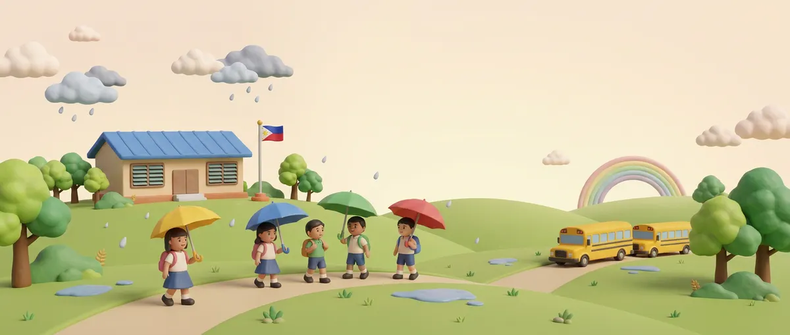

# D3: Monthly Calendar print (with customization)

Part D3 of School Planning (`docs/plans/school-calendar-and-ppa.md`). **D3 is only the printed
Monthly Calendar.** The AIP (Annex 10) and the Work Plan and Budget Matrix (Annex 9) move to a
later PR. It sits behind the same `plan` feature switch (Testing ES first) and gets its own What's
new entry (`pilot: 'plan'`).

Decisions (answered 2026-11-21):

| # | Question | Answer |
|---|---|---|
| A | Background art | Clay-style themes: one per month, plus general scenes to switch to, **and** the school's own photo or banner |
| B | What can be customized | Everything: art theme and strength, colour accent, paper and orientation, which entries show, header with logo and school name, a motto or note line, week start |
| C | Paper and layout | The person printing chooses: A4 or Legal, landscape or portrait; one month or a range of months (e.g. the whole SY, June to April) as one print / PDF |
| D | Who prints | Everyone: School Head, AO and teachers (e.g. for their classroom) |



*Sample art for June, in the same clay style as the sign-in screen. The upper middle is left plain
so the month name prints over it.*

## 1. Where it is

- **Print** button on the calendar's Month view (and in the Agenda header), for everyone who
  sees the calendar: the AO's Calendar page, the School Head's Plan tab, the teacher's Calendar tab.
- It opens a **Print the calendar** sheet with a **live preview** of the page on top (scaled to
  the phone, tap to zoom) and the options under it. On computers: preview on the left, options
  in a side column. **Print** at the bottom uses the browser's print (Save as PDF works too), as
  the other forms do.
- Phone first: the options are grouped in folding sections (Art, Page, What to show, Header) so
  the sheet stays short.

## 2. The page

```
┌───────────────────────────────────────────────────────────────┐
│ [logo]  OQUENDO ELEMENTARY SCHOOL · School ID 644584           │  header (optional)
│         Division of … · SY 2026–2027                          │
│ ░░░░░░░░░░░ clay art banner ░░░░░░  JUNE 2026  ░░░░░░░░░░░░░░ │  art + month title
│ ░░░░░░░░░░░░░░░░░░░░░░░░░░░░░░░░░░  Term 1 · 14 class days ░░ │
├────────┬────────┬────────┬────────┬────────┬────────┬────────┤
│  MON   │  TUE   │  WED   │  THU   │  FRI   │  SAT   │  SUN   │
├────────┼────────┼────────┼────────┼────────┼────────┼────────┤
│ 1      │ 2      │ …      │        │        │        │        │
│Brigada │        │        │        │12 ■    │        │        │  ■ = no classes (soft red fill)
│Eskwela │        │        │        │Indep.  │        │        │  ● = activity (indigo), ★ = event
│        │        │        │        │Day     │        │        │  ▲ = exam (violet)
├────────┼────────┼────────┼────────┼────────┼────────┼────────┤
│ …                                                             │
├───────────────────────────────────────────────────────────────┤
│ Notes / legend: ■ No classes ● Activity ★ School event ▲ Exam │  footer
│ "Motto or note line"                  Printed Nov 21, 2026    │
└───────────────────────────────────────────────────────────────┘
```

- **Day boxes:** the date, small kind marks, and the entries' titles (time for activities if
  set). A box that runs out of room ends with "+2 more", and those entries go in a
  **More this month** list under the grid, so nothing is lost.
- **Days without classes** get a soft tinted fill. Weekends are lighter. Days outside the SY are
  greyed. Today is never highlighted (it is a print).
- **Multi-day entries** (breaks, Brigada Eskwela) are shown as one bar across the days in that
  week where the layout allows; otherwise in each day.
- **Under the title:** the term and block (*Term 1 · Instructional*) and the class days in the
  month (*14 class days*), from D1's class-day count. Each can be switched off.
- **Range of months:** one month per page, page breaks between months, each with its own
  month's art. A whole SY (June to April) is 11 pages.

## 3. Customization

| Group | Options | Default |
|---|---|---|
| **Art** | Theme: **This month's art** (auto), one of the general scenes, **School photo**, or **None** | This month's art |
| | Strength: Full · Soft (faded behind the title) · Light (watermark behind the whole grid) | Full |
| | Position: Top banner · Whole page behind the grid (watermark) | Top banner |
| **Colour** | Accent for the title, day headers and lines: Teal (app), Blue, Green, Red, Violet, Orange, Black and white (saves ink) | Teal |
| **Page** | A4 or Legal (8.5 × 13 in), landscape or portrait | A4 landscape |
| | Months: this month · a range (from / to) · the whole SY | this month |
| | Week starts on Monday or Sunday | Sunday (wall-calendar style) |
| **What to show** | Holidays · No classes · Exams · School events · Activities · DepEd national dates · **Mine only** (a teacher's own activities) · times · venues · people responsible | all on except DepEd national, Mine only, venues and people |
| | Term and class-day line | on |
| **Header** | School logo (from the school's settings, or upload) · school name · School ID · division / district line · SY | logo if any, name, SY |
| **Footer** | A legend · a motto or note line (e.g. the school's vision, "Approved: [School Head]") · printed date | legend and printed date |

- **Ink saver:** Black and white plus Art None prints only lines and text.
- Options are **remembered on the device** (localStorage) for that person, so the next print
  looks the same. Saving them as the school's shared style is not part of D3 (it can come later
  if wanted).

## 4. The art

**Monthly clay themes (12)**, matched to the Philippine school year:

| Month | Theme |
|---|---|
| January | New Year, back from the Christmas break, Term 3 begins |
| February | Hearts, National Arts Month, friendship |
| March | Fire Prevention Month, summer heat, end-of-term exams |
| April | Moving up and graduation, summer break |
| May | Flores de Mayo, fiesta buntings, Brigada Eskwela getting ready |
| June | Back to school, rainy season, umbrellas, Independence Day flag (sample above) |
| July | Nutrition Month, fruits and vegetables, rainy days |
| August | Buwan ng Wika, Filipino culture, books |
| September | Science and math, Term 2 begins |
| October | World Teachers' Month, apples and thank-you cards, UN flags |
| November | Reading Month, books and library, cool weather |
| December | Christmas, parol lanterns, simbang gabi, gifts |

**General scenes (6), to pick instead:** School grounds (the sign-in art) · Classroom · Library and
books · Sports and Palaro · Nature and garden · Celebration / program stage.

- Made once in the same soft clay style as the sign-in screen, with the upper middle left plain
  for the month title. Saved as small WebP files (about 30–50 KB each, ~0.8 MB for all 18) in
  `assets/cal-art/`. **Not precached:** each one is fetched when it is first used in a print, then
  kept by the service worker (like the OCR and Firebase files), so the app's first load does not
  grow.
- **School photo / banner:** pick a picture on the device. The app shrinks it (about 1600 px
  wide, WebP / JPEG ≤ 300 KB). It is kept **on that device** (IndexedDB) for its prints, so it
  costs no cloud storage or reads (the app is on Firebase Spark with no Storage). A school that
  wants the same photo on every device uploads it on each one. A crop handle chooses which part
  shows in the banner.
- **Dark mode:** the print always uses the light art and a white page.

## 5. Print quality

- Built as HTML in the existing print area (`@page` size and orientation set per print), like
  the other forms; checked with Chrome's Save as PDF on A4 and Legal, both orientations.
- Background art and fills print because the page uses `print-color-adjust: exact` (the sheet
  reminds people to tick **Background graphics** in the print box if a browser ignores it).
- Text sizes shrink a little in portrait and when a month has many entries, so a month stays on
  one page.

## 6. Data and rules

- **Nothing new in Firestore.** The print reads what the calendar already has (`planYears/{sy}`
  and `ppas`). Options and the school photo stay on the device. **No rules change**, so there is
  nothing to publish for D3.

## 7. Tests (`tests/e2e/plan-print.mjs`)

- Print button for the AO, the School Head and a teacher; none at a school without the switch.
- One month: the grid has the right first weekday (Monday / Sunday start), the number of days,
  the days without classes tinted, the holidays and events in their boxes, "+N more" with the
  **More this month** list.
- Options: theme auto picks that month's art; general scene; None; Black and white; paper and
  orientation set the `@page` rule; What-to-show switches remove entries; Mine only shows only a
  teacher's activities; the header shows the school name and SY; the motto line prints.
- Range: June to April gives 11 pages, each with its own art.
- School photo: a picked picture is shrunk, kept on the device, and used in the banner.
- Options are remembered after a reload. `window.__printed` after Print. No page errors.

## 8. Build steps (one PR)

1. Make the 12 monthly + 6 general clay images (WebP) in `assets/cal-art/`; service worker: cache
   on first use.
2. Print sheet (preview + options) and the page builder (`calPrintHTML(opts, months)`).
3. School photo picker (shrink, IndexedDB, crop).
4. Print buttons on the three calendar views.
5. New suite, README "School calendar" section, What's new (`pilot: 'plan'`).

**Later (not in D3):** AIP (Annex 10) and Work Plan and Budget Matrix (Annex 9) prints, a
12-month poster on one page, the school's saved shared print style.
